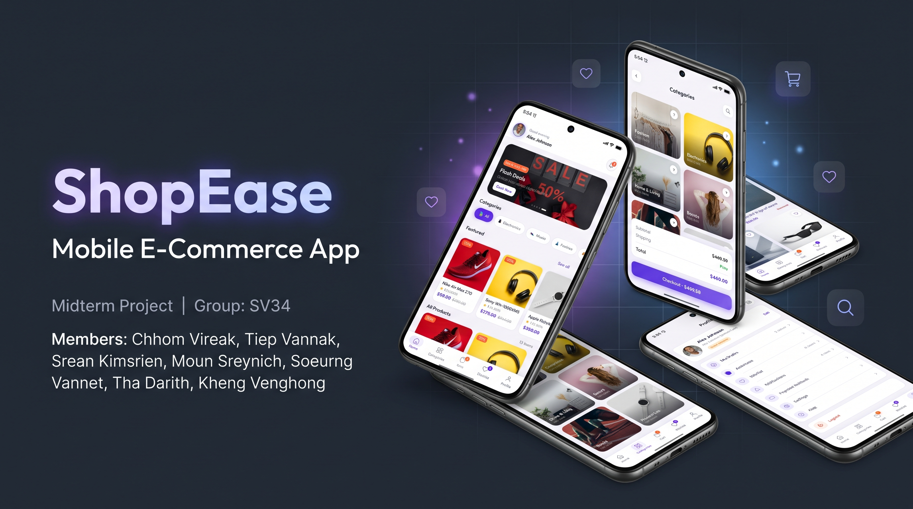
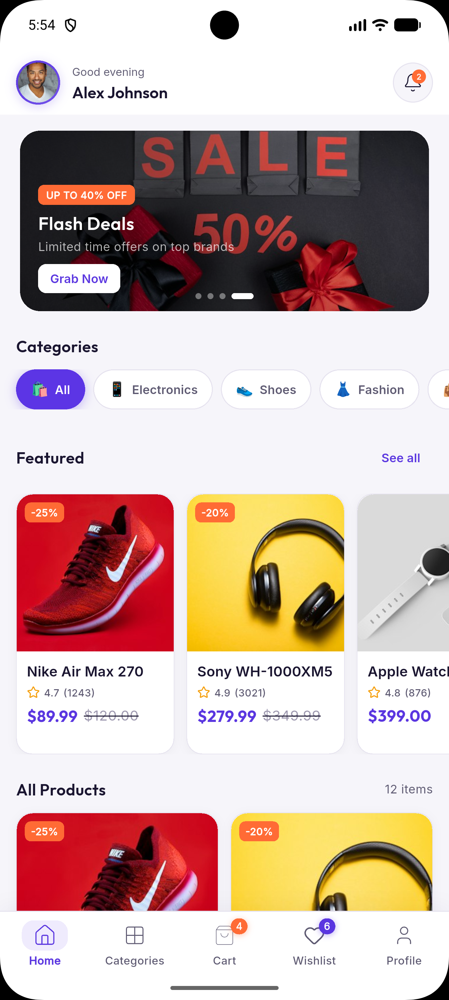
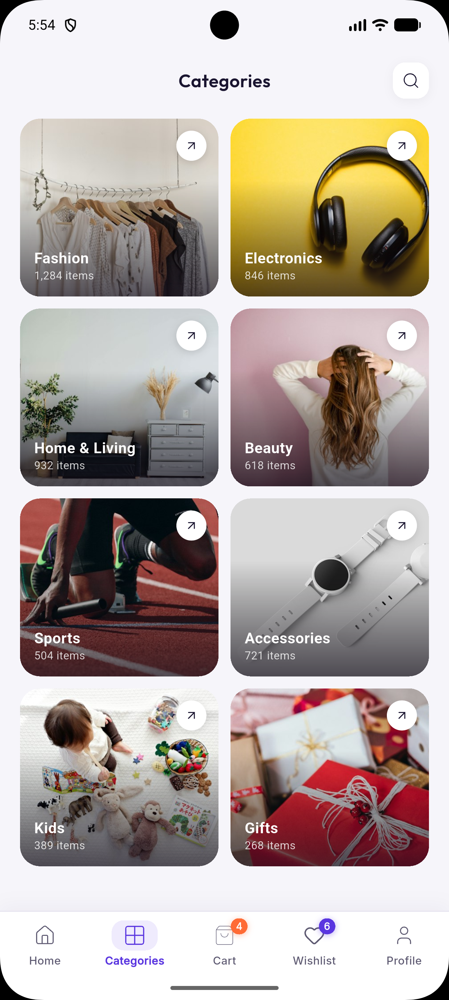
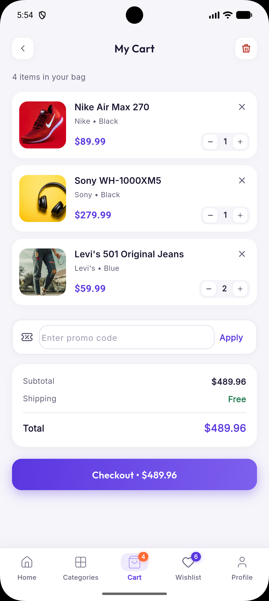
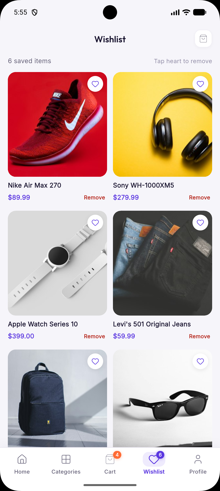
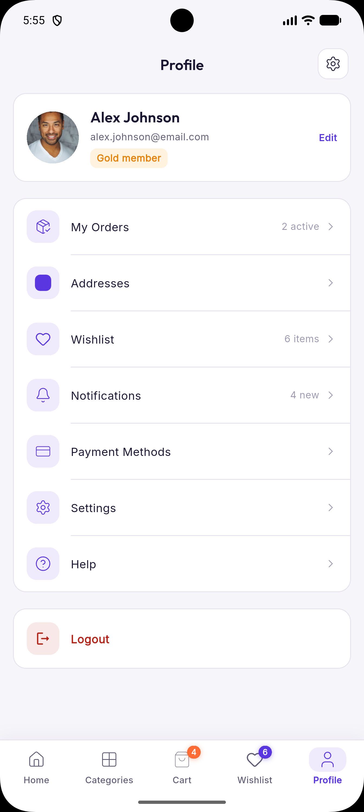

<div align="center">



# ShopEase — Mobile E-Commerce App

[](https://flutter.dev)
[](https://dart.dev)
[](https://riverpod.dev)
[](LICENSE)
[](https://flutter.dev)

> **Midterm Project · Group SV34**  
> A pixel-perfect Flutter e-commerce application built with clean architecture, smooth animations, and a premium purple design system.

</div>

---

## 📱 App Screenshots

<div align="center">

| 🏠 Home | 🗂️ Categories | 🛒 Cart |
|:---:|:---:|:---:|
|  |  |  |

| ❤️ Wishlist | 👤 Profile |
|:---:|:---:|
|  |  |

</div>

---

## ✨ Features

| Feature | Description |
|---------|-------------|
| 🎨 **Premium UI** | Purple-violet design system with smooth micro-animations |
| 👤 **User Profile** | Personalized greeting & avatar in the home app bar |
| 🛍️ **Product Discovery** | Searchable catalogue with category filters & banners |
| 🛒 **Smart Cart** | Add/remove items, promo codes, and real-time totals |
| ❤️ **Wishlist** | Save favorites across sessions |
| 📦 **Order Tracking** | Live order status & detailed order history |
| 🔔 **Notifications** | In-app notification center with unread badge |
| 💳 **Checkout Flow** | Address, payment method selection & KHQR support |
| 🚀 **Onboarding** | Full-bleed animated onboarding with slide indicators |
| 🌈 **Animations** | Fade-slide transitions, bouncing taps, shimmer loaders |

---

## 🏗️ Architecture & Tech Stack

```
lib/
├── app/               # Router (go_router)
├── core/
│   ├── animations/    # Custom animation widgets
│   ├── mock/          # Mock data models & providers
│   ├── providers/     # Riverpod state providers
│   ├── theme/         # Design tokens (colors, text styles)
│   └── widgets/       # Shared reusable widgets
└── features/
    ├── auth/          # Login & Register
    ├── cart/          # Shopping cart
    ├── categories/    # Category browser
    ├── checkout/      # Checkout & KHQR payment
    ├── home/          # Home feed & banners
    ├── notifications/ # Notification center
    ├── onboarding/    # Splash & onboarding
    ├── orders/        # Order list & detail
    ├── product/       # Product detail & reviews
    ├── profile/       # Profile & settings
    ├── search/        # Search & filter
    ├── shell/         # Bottom nav shell
    └── wishlist/      # Saved items
```

### Key Packages

| Package | Purpose |
|---------|---------|
| `flutter_riverpod` | Reactive state management |
| `go_router` | Declarative navigation |
| `cached_network_image` | Efficient image loading & caching |
| `google_fonts` | Outfit & Inter typography |
| `flutter_svg` | SVG icon rendering |

---

## 🚀 Getting Started

### Prerequisites

- Flutter SDK `≥ 3.0.0`
- Dart SDK `≥ 3.0.0`
- Android Studio / VS Code with Flutter extension

### Installation

```bash
# 1. Clone the repository
git clone https://github.com/vannet-855/ShopEaseApp.git

# 2. Navigate to project directory
cd ShopEaseApp

# 3. Install dependencies
flutter pub get

# 4. Run the app
flutter run
```

### Build for Release

```bash
# Android APK
flutter build apk --release

# iOS (macOS only)
flutter build ios --release
```

---

## 👥 Team Members

| Name | Role |
|------|------|
| **Chhom Vireak** | UI/UX & Frontend |
| **Tiep Vannak** | State Management & Architecture |
| **Srean Kimsrien** | Product & Cart Features |
| **Moun Sreynich** | Auth & Profile Screens |
| **Soeurng Vannet** | Onboarding & Animations |
| **Tha Darith** | Orders & Checkout Flow |
| **Kheng Venghong** | Search & Categories |

---

## 📄 License

This project is built for academic purposes as a **Midterm Project** at **SETEC Institute**, Year 4, Semester 1, Mobile Applications course.

---

<div align="center">

Made with ❤️ and Flutter · **Group SV34 · SETEC Institute**

</div>
